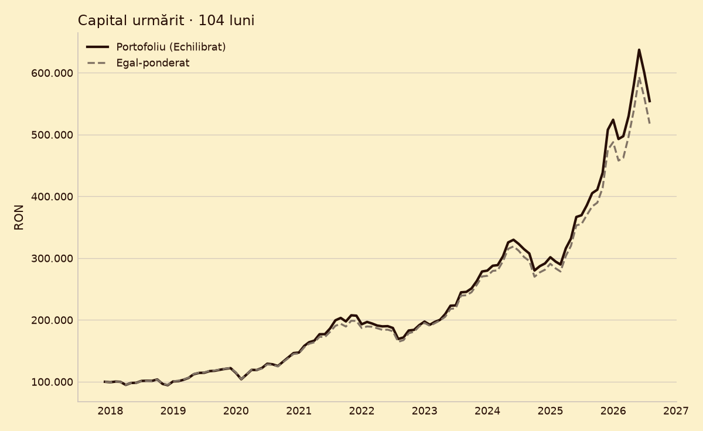
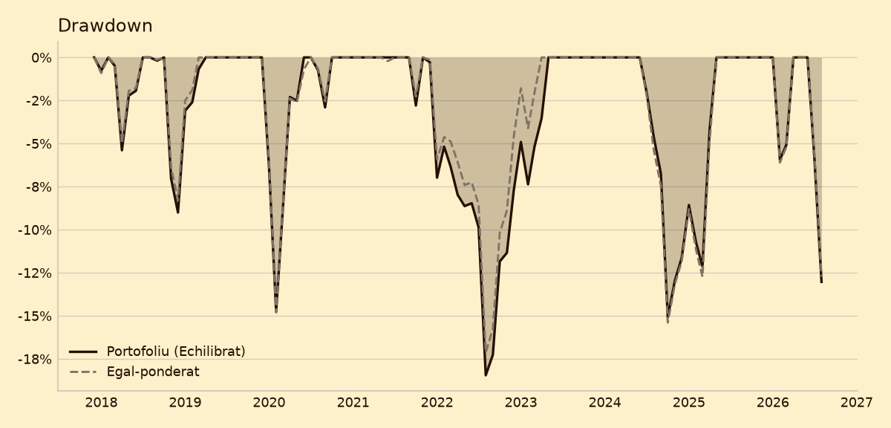
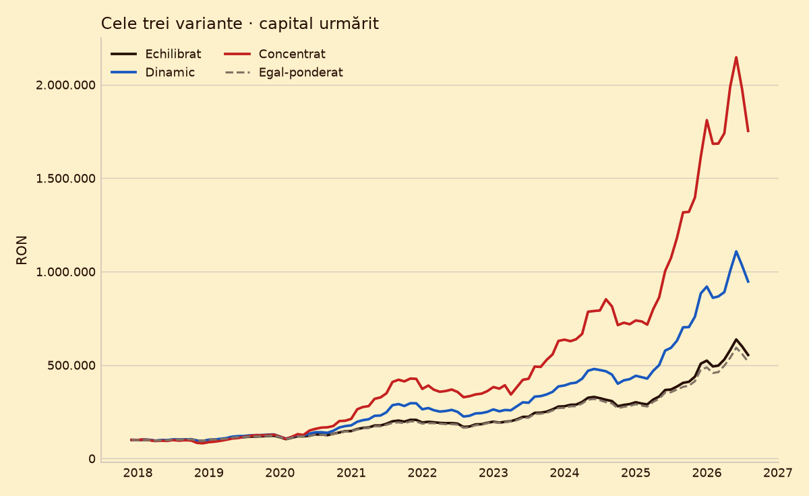
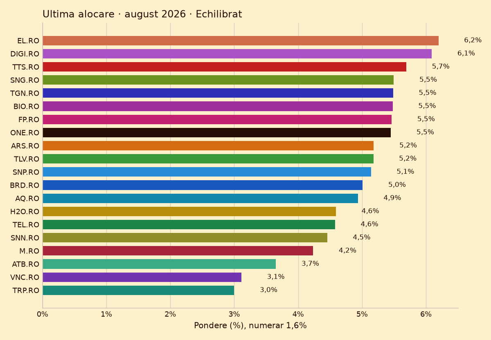

# YEBICHU Romania

> **Acest fișier este generat automat la publicarea site-ului. Nu îl edita manual: orice modificare se pierde la următoarea publicare.**

**Abstract (EN).** YEBICHU Romania is a rules-based, long-only equity index over the 20 most liquid blue chips of the Bucharest Stock Exchange. The published allocation is produced by a small neural network that is recalibrated every month on history since 2015, with a hard cap per asset and a cash position. Three variants express how much active risk the portfolio may take: *Balanced* tracks the equal-weighted index, *Dynamic* takes a moderate tilt, *Concentrated* minimises entropy. This page is a static report; nothing here is investment advice.

## Fișa indicelui

| | |
| --- | --- |
| Nume | YEBICHU Romania |
| Piață | BVB |
| Monedă | RON |
| Univers | 20 de acțiuni |
| Membri (ultima lună) | 20 |
| Luni urmărite | 104 (ianuarie 2018 .. august 2026) |
| Istoric de la | ianuarie 2015 |
| Capital inițial | 100.000 RON |
| Dimensiunea modelului | 1.018 de parametri |
| Arhitectură | rețea neuronală feed-forward cu 32 unități ascunse, 1 strat de encoder pe active, decoder de 16 unități, plafon de 30% per activ |
| Referință: egal-ponderat | CAGR 20,90% · drawdown maxim -17,13% |

## Grafice

## Variantele

| Variantă | ENB (din 20) | Pondere maximă | Plafon per activ | Corelație cu egal-ponderatul | CAGR | Drawdown maxim | Exces CAGR | Parametri |
| --- | --- | --- | --- | --- | --- | --- | --- | --- |
| **Echilibrat** | 18,8 | 6,5% | 30% | 0,995 | 21,85% | -18,45% | +0,95% | 1.018 |
| **Dinamic** | 9,5 | 17,9% | 41% | 0,932 | 29,62% | -24,10% | +8,72% | 1.018 |
| **Concentrat** | 4,6 | 45,6% | 50% | 0,787 | 39,16% | -23,32% | +18,26% | 1.018 |

Fiecare variantă are același model și aceeași fereastră de evaluare; diferă doar cât de mult se poate abate de la egal-ponderat (ENB = numărul efectiv de pariuri, 1/Σw²).

* **Echilibrat** — Diversificare întâi: urmărește egal-ponderatul indicelui (ENB ~20 din 20), abateri mici și rulaj redus.
* **Dinamic** — Tilt activ moderat: ENB ~10 din 20, acceptă tracking error mai mare pentru exces mai mare.
* **Concentrat** — Concentrare maximă: cea mai mică entropie dintre variante (ENB ~3-4 din 20), până la ~45% pe un nume, plafon 50%, fără prag de diversificare.

## Metodologie

Politică de alocare neuronală long-only pe primele 20 de blue-chip-uri lichide de la Bursa de Valori București, cu model recalibrat lunar pe istoricul din 2015 și plafon de 30% per activ.

Sumar: fiecare acțiune intră în model cu randamentul pe 1, 3, 6 și 12 luni, volatilitatea realizată pe 3 luni și rangul relativ al randamentului de 1 lună; un encoder partajat învață o reprezentare comună, iar decoderul produce ponderi long-only care însumează 100%, cu numerar ca poziție de apărare.

## Cum este întreținut

* Recalibrare lunară pe istoricul de la ianuarie 2015.
* Rebalansare în ziua 15 a lunii, execuție în ziua 16.
* Plafon de 30% per activ, aplicat înainte de publicare.
* Fereastra de evaluare: ianuarie 2018 .. august 2026 (104 de luni).
* Rulaj mediu lunar: 16,4%; numerar mediu: 2,7%.

## Linkuri

* Site: <https://index.yebichu.com>
* Oglindă GitHub Pages: <https://yebichu.github.io/index-lander/>

## Precizări

* Nu este sfat de investiții și nu este o recomandare de tranzacționare.
* Randamentele trecute nu garantează randamente viitoare.
* Rezultatele sunt simulate pe date istorice, după costuri de tranzacționare și comision de rulaj.
* Capitalul urmărit pornește de la 100.000 RON și este exprimat în moneda indicelui.
* Datele publice pot fi folosite liber, cu condiția să nu fie prezentate ca sfat de investiții.
